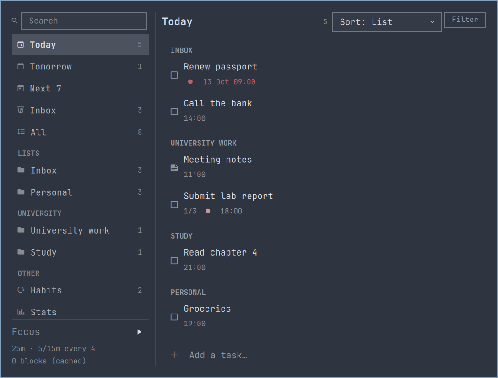
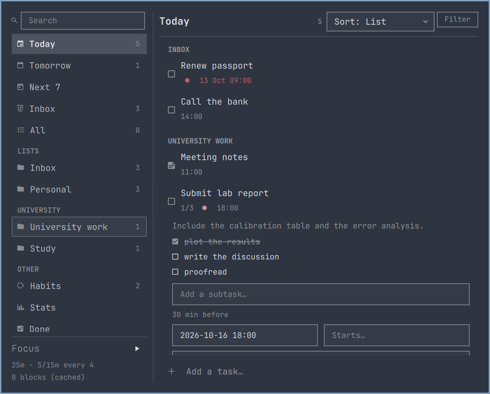
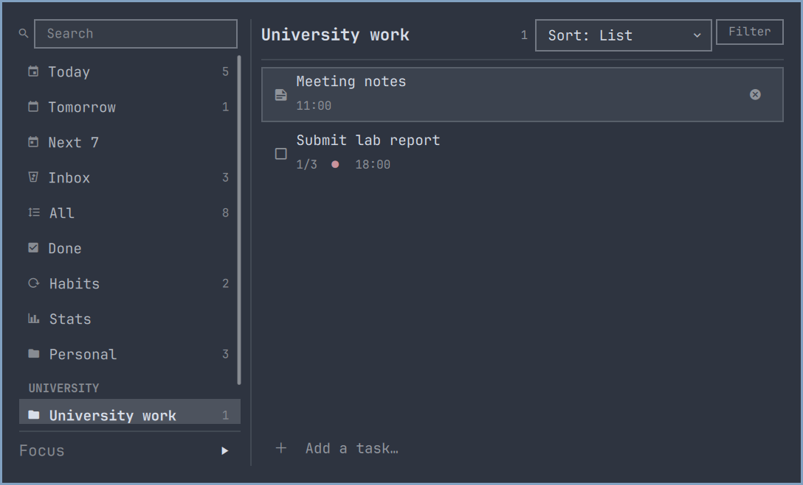

<p align="center">
  <picture>
    <source media="(prefers-color-scheme: dark)" srcset="docs/img/hero-dark.svg?v=e9b13d9">
    <source media="(prefers-color-scheme: light)" srcset="docs/img/hero-light.svg?v=e9b13d9">
    
  </picture>
</p>

<p align="center">
  <a href="https://github.com/dddaniel1/omarchy-dida/actions/workflows/ci.yml"></a>
  <a href="LICENSE"></a>
  <a href="https://omarchy.org/"></a>
  
  <a href="https://www.python.org/"></a>
  
</p>

<p align="center">
  <b>Your tasks in the bar.</b> Grouped by list, the way TickTick does it.<br>
  Every edit lands <b>instantly and locally</b>, then syncs in the background — so a
  train tunnel is not an outage.
</p>

<p align="center">
  <br>
  <sub>Overdue and due today, urgent-coloured when you are behind. Notes are not counted.</sub>
</p>

> **Fork.** `dddaniel1.dida365` (displayed as **Dida 365**) is a fork of
> [`siam.ticktick`](https://github.com/EhsanulHaqueSiam/omarchy-ticktick), hosted in the
> [`omarchy-dida`](https://github.com/dddaniel1/omarchy-dida) workspace. It defaults to
> **Dida365 (滴答清单, `api.dida365.com`)** instead of the international
> `api.ticktick.com`, and picks the OAuth endpoints and developer console from whichever
> of the two a sign-in targets. The code, the architecture and the MIT license are
> upstream's; the fork changes the plugin id, the default API host, and the host-aware
> sign-in. See the workspace's `COMPARISON.md` for what upstream does and does not do.

---

<table>
<tr>
<td width="34%" valign="top" align="center">
  <br>
  <sub><b>Sections are your lists.</b><br>Inbox · University work · Study · Personal</sub>
</td>
<td width="34%" valign="top" align="center">
  <br>
  <sub><b>Edit anything, from the keyboard.</b><br>Dates, tags, repeat, reminder, subtasks</sub>
</td>
<td width="32%" valign="top" align="center">
  <br>
  <sub><b>Lists nest under folders.</b><br>Just like the TickTick sidebar</sub>
</td>
</tr>
</table>

Sections follow the sort: **by list** is the default, the way TickTick groups a smart
list. <kbd>o</kbd> cycles to date (Overdue / Today / Tomorrow), priority or title.
Notes render with a **▤** and never reach the badge — only to-dos are counted.

## Requirements

> [!IMPORTANT]
> **Omarchy 4 ("Quattro") or newer — which is not released yet.** Omarchy 3.x cannot run
> this plugin, and no flag or backport changes that: it has no shell to load it into.

| | Needed | Why |
|---|---|---|
| **Omarchy** | **4.0** — today that means the `quattro` branch tip, version `4.0.0.alpha` | 4.0 is the first version with a Quickshell shell *and* the first with third-party plugins. Both arrived together, so 4.0 is also the earliest version this could ever have supported. |
| **Quickshell** | **0.3.x** — Omarchy's own `quickshell-git` build (`0.3.0.r18` or newer) | The widget is QML against the `qs.Ui` / `qs.Commons` singletons the Omarchy shell publishes. Omarchy's `omarchy-restart-shell` needs the git build specifically: release 0.3.0's `quickshell kill` returns before the shell has exited. |
| **Plugin manifest** | `schemaVersion: 1`, `kinds: ["bar-widget"]` | The contract this plugin's [`manifest.json`](manifest.json) is written against. The registry rejects any other `schemaVersion` outright — it is an exact match, not a floor. |
| **Python** | 3.11+, standard library only | The `ticktick` helper. Omarchy already has it. |

Why 3.x is a hard no: Omarchy replaced Waybar with a Quickshell shell in
[Omarchy 4](https://github.com/basecamp/omarchy/pull/6231), and third-party plugins are a
feature *of that shell*. The v3.8.4 tree — the newest stable release as of July 2026 —
contains neither a `shell/` directory nor an `omarchy plugin` command, so on 3.x there is
nothing to install into.

<details>
<summary>Checking what you are on, and getting Quattro if you are not</summary>

```bash
omarchy version                 # 4.0.0.r… means you are on Quattro
cat /usr/share/omarchy/version  # 4.0.0.alpha
omarchy plugin list             # if this errors, your Omarchy is too old
```

Quattro is unreleased and ships as the `omarchy-dev` package — *"Arch Linux by DHH
(quattro branch tip)"* — from Omarchy's own pacman repo. It tracks a moving branch, so
expect it to move under you. Once Omarchy 4 is tagged, the stable package is the one you
want, and this table becomes "Omarchy 4.0 or newer" with nothing else to think about.
</details>

## Install

### Install or package a local checkout

```bash
./scripts/install.sh          # Validate, copy this working tree, reload and enable
bash scripts/package.sh      # Create dist/dddaniel1.dida365-1.0.3.tar.gz
```

To install the archive on another Omarchy 4 machine:

```bash
tar -xzf dist/dddaniel1.dida365-1.0.3.tar.gz
cd dddaniel1.dida365
./scripts/install.sh
```

The archive includes the Python helper and installer; no compilation or pip packages
are needed. Installation requires `python3`, `jq`, `rsync` and Omarchy 4. Use
`./scripts/install.sh --link` for live development, or `--no-reload` to copy files
without enabling the widget. Local snapshot installs are updated by running the
installer again; `omarchy plugin update` is for git installs.

### Install from GitHub

**1 — add the plugin.**

```bash
omarchy plugin add https://github.com/dddaniel1/omarchy-dida.git --enable
```

That is a `git clone` into `~/.config/omarchy/plugins/dddaniel1.dida365/` and nothing else —
no build step, no `pip install`, no daemon, no Node. The helper is standard-library
Python 3.11+, which Omarchy already has.

**2 — install the `ticktick` CLI.** The widget is a thin shell over it: everything the
popup does, it does by running this. It ships inside the plugin, and the widget always
calls it by its full path — but you want it on your `PATH` too, because it is how you
sign in from a terminal, script your tasks, and diagnose anything that goes wrong. Every
command in this README assumes it is there.

```bash
mkdir -p ~/.local/bin
ln -sf ~/.config/omarchy/plugins/dddaniel1.dida365/bin/ticktick ~/.local/bin/ticktick
ticktick --version
```

**3 — sign in.** Click the widget → **Sign in with browser**. That is the whole setup.

<details>
<summary>Placing and updating the widget</summary>

```bash
omarchy bar plugin move dddaniel1.dida365 center   # left | center | right
omarchy plugin update dddaniel1.dida365            # shows a diff, then fast-forwards
omarchy plugin remove dddaniel1.dida365
```
</details>

## Signing in

**Sign in with browser** is the button the widget leads with. It opens a terminal,
sends you to TickTick in your browser, and catches the redirect back. The first run asks
once for a **Client ID** — TickTick issues no shared one, so every client needs an app of
its own:

1. open the [TickTick Developer Center](https://developer.ticktick.com/manage) → **New App**
2. set its redirect URI to exactly `http://localhost:8080/callback`
3. paste the Client ID when the terminal asks

No client secret is needed: the flow uses **PKCE**, because a secret shipped inside a
program on someone else's machine is not a secret. The id is remembered, so this is asked
once ever.

```bash
ticktick auth                                  # same flow, from a terminal
ticktick auth --redirect http://localhost:9000/callback
```

### Or paste an API token

Faster if you already have one, and the fallback if the browser flow cannot run — behind
**Paste an API token instead** in the widget. Get it from the TickTick web app: avatar →
**Settings → Account → API Token**.

```bash
ticktick login          # prompts, reads the token from stdin
ticktick status
```

The token is passed to the helper over **stdin**, never on the command line, because
anything in `argv` is readable by every process on the machine through
`/proc/<pid>/cmdline`. It is stored at `~/.config/ticktick/credentials.json`, mode
`0600`. Nothing is sent anywhere except the API host you signed in against
(`api.dida365.com` by default).

**Already signed in to [TickTick's own CLI](https://www.npmjs.com/package/@ticktick/ticktick-cli)?**
Then you are already signed in here — its token is picked up automatically from
`~/.config/ticktick-cli/config.json`. That file is only ever read, never written, and
`ticktick logout` stops the borrowing for good.

<details>
<summary>Using the international TickTick instead of Dida365?</summary>

`api.dida365.com` is the default. `api.ticktick.com` is a separate service with
separate accounts and the same API shape, and the browser flow, the error messages and
the stored `api_base` all follow whichever one you sign in against. Point the helper at
it once, when you sign in:

```bash
ticktick login --api-base https://api.ticktick.com/open/v1
```

`TICKTICK_API_BASE` in the environment overrides the stored base for a single command.
</details>

## Using it

The sidebar offers **Dates** for important dates. Add/edit habits in Habits, open
comments from task details, and select tasks for bulk actions. Lists and Settings
hold organization and account tools. The focus area includes a stopwatch and history.
See [additional API features and CLI examples](docs/API-FEATURES.md).

### Mouse

| Where | Action |
|---|---|
| Bar button | left = popup · right = refresh now · middle = jump to quick-add |
| Task row | click the checkbox = complete · click the title = expand detail |
| Finished row | ticked and struck through, dated by completion; click its checkbox again to restore it to unfinished (requires a connection, preserves the task fields and verifies server state) |
| Expanded detail | tick a subtask · remove one with the ✕ that appears · pick a list, repeat or reminder |
| Note row | opens like any other; it has no checkbox, because a note is not a task |

### Keyboard

The popup is fully keyboard-driven — the mouse is optional. Open **Settings → Keyboard shortcuts**
or press <kbd>?</kbd> for the in-panel reference, including the current view-number mapping.

| Key | Action |
|---|---|
| <kbd>↑</kbd> <kbd>↓</kbd> / <kbd>k</kbd> <kbd>j</kbd> | move the cursor |
| <kbd>Enter</kbd> | complete the task under the cursor |
| <kbd>Space</kbd> | expand / collapse its detail |
| <kbd>←</kbd> <kbd>→</kbd> / <kbd>h</kbd> <kbd>l</kbd> | switch view; right arrow leaves the sidebar |
| <kbd>Tab</kbd> / <kbd>Shift+Tab</kbd> | switch between list and sidebar; enter forms or the statistics calendar |
| <kbd>?</kbd> | open keyboard shortcuts |
| <kbd>1</kbd>–<kbd>8</kbd> | jump to a view — Today, Tomorrow, Next 7, Inbox, All, Done, Habits, Stats; the digits follow the sidebar, so hiding Habits or Stats drops them out |
| <kbd>a</kbd> | quick-add |
| <kbd>/</kbd> | search |
| <kbd>o</kbd> | cycle sort — list, date, priority, title (this also sets the headings) |
| <kbd>f</kbd> | filter by priority and tag; <kbd>Esc</kbd> clears it |
| <kbd>p</kbd> | cycle priority |
| <kbd>P</kbd> | start / pause / resume the focus timer |
| <kbd>x</kbd> / <kbd>d</kbd> | delete (with confirmation) |
| <kbd>r</kbd> | refresh the current task, habit, or important-date list now |
| <kbd>s</kbd> | sync tasks — push anything queued and refetch; refresh habits or important dates |
| <kbd>Esc</kbd> | back out one layer, then close |

Task, habit, and important-date lists also have a **Refresh** button with a loading
state. Manual task and habit refreshes bypass the cache; automatic reads remain
cache-first. <kbd>s</kbd> additionally pushes queued task changes.

### Habits

The **Habits** view is the account's habit list, with today's state on every row: a
filled mark for a finished day, the streak beside it once it is more than a day, and a
tally for a quantified habit (`2/8 cups`). <kbd>Enter</kbd> or a click checks a habit in
— one click for a finish-in-one habit, one *step* for a quantified one, and a click on a
finished day un-finishes it. A habit outside its own repeat rule is dimmed and marked
`not today` rather than hidden, so a weekly habit does not look deleted on the other six
days.

Choose **Add habit**, enter a name, and press <kbd>Enter</kbd> to create a daily,
finish-in-one habit. Choose **Reach a quantity** for a goal, amount per check-in,
and optional unit. Saving clears the form only after success; a failed request
keeps your input for retrying. Editing preserves an existing custom schedule.

The bar counts open habits beside the task count: `3  2♦` is three tasks due and two
habits still open. The `<kbd>1</kbd>`–`<kbd>8</kbd>` shortcut and the tab only appear
when `showHabits` is on.

### Focus

The **focus timer** is a pomodoro that uploads each finished block to the account's
focus statistics. It appears as a strip in the panel and counts down in the bar while it
runs, outranking the task count — it is the number with seconds on it.

| Control | Action |
|---|---|
| Start / <kbd>P</kbd> | begin an independent focus block |
| ▶ on a task row | begin a focus block linked to that task |
| Pause / <kbd>P</kbd> | stop the clock where it is; nothing is recorded |
| Resume / <kbd>P</kbd> | carry on from where it stopped |
| Discard (⏹) | throw the block away, unrecorded |

Only a completed focus block is uploaded, and a completed break is not uploaded at all —
the account counts pomodoros, and banking half a block or a break would inflate a
statistic it shows on every device. Durations come from the settings below; the account
has no focus settings of its own to defer to.

The strip shows what the block is doing — its phase, whether it is paused, the linked
task, and today's tally — only while one is running, and idle it is just a Start button.
The durations in force ride that button's tooltip rather than sitting under the timer as
a permanent readout.

The task's name appears beneath the timer and stays there when changing views or
restarting the shell. Task start buttons are disabled while a timer is running or
paused, and unavailable on notes, completed tasks or unsynced drafts. A completed
linked block includes the task ID in its focus record; it does not complete the task.

The timer's state lives in `~/.local/state/ticktick/focus.json` rather than in the
widget, which is what makes several monitors share one clock and a block survive a shell
restart. It also means the countdown is not lost when the panel closes.

### Statistics

The **Stats** view is a read-only dashboard assembled from everything the widget already
knows. Use ↑/↓ or j/k to scroll, Page Up/Down to move a page, and Home/End to jump.
Press Tab to inspect heatmap dates with the arrow keys; Esc returns to the panel.

- **Completed** — a bar per day over the **Done** window (`completedDays`), from the one
  endpoint that can see finished work. Periods over fourteen days are grouped by week.
- **Activity heatmap** — five columns of weeks with seven weekday cells each, showing
  daily completion intensity with explicit 0 / 1 / 2–3 / 4+ levels. Its full history
  is fetched independently of the trend window.
- **Open work** — list, priority and tag bars based on all outstanding tasks. List
  percentages match bar lengths, full names wrap, and tasks with several tags count
  toward each tag.
- **Habits and focus** — the day's check-in tally, the best current streak, and how many
  pomodoros and minutes were logged today.

It is fetched on demand — entering the view is what asks for it — so nothing rides the
poll. Refresh (or r/s) updates statistics; update time, cached task data and partial
warnings are shown. Missing completion history appears as unavailable, not zero.
`showStats` turns the view, its sidebar entry and its number key off together.

### Notes vs tasks

TickTick lets a list hold notes as well as tasks. A note has no checkbox and nothing to
finish, so it shows with a **▤** glyph, cannot be completed, and never counts toward the
bar badge, the section counts or a list's count. Only to-dos are counted.

### Editing a task

<kbd>Space</kbd> opens a task's detail, where everything about it is editable without
leaving the keyboard: due date and start date (in the same natural language quick-add
takes — `tomorrow 5pm`), tags, repeat, reminder, which list it belongs to, and its
subtasks. An empty due field committed with <kbd>Enter</kbd> clears the date.

### Natural-language quick add

Type a whole task in one line. Anything it does not recognise stays in the title
verbatim, so `call #1 supplier` is left alone rather than mangled.

```
submit report tomorrow 5pm !high #work
pay rent on the 1st !medium *monthly
dentist next tuesday 9:30am
review PR in 3 days
```

| Token | Meaning |
|---|---|
| `today` `tomorrow` `tonight` `mon`…`sun` `next monday` `in 3 days` `eod` `eow` `2026-08-14` `14 aug` | due date |
| `5pm` `5:30pm` `17:30` `@9am` `noon` `midnight` | time of day (without one, the task is all-day) |
| `!high` `!medium` `!low` `!none` (`!p1`…`!p0`) | priority |
| `#work` `#"two words"` | project (falls back to your default if unknown) |
| `*daily` `*weekly` `*monthly` `*weekdays` `*every 3 days` | repeat rule |

Preview the parse without creating anything:

```bash
ticktick parse "submit report tomorrow 5pm !high #work"
```

## The sync engine

Nothing you do here waits on the network. Every read is answered from a local cache and
every write is applied locally first, queued on disk, and sent when it can be:

```
 keystroke ──▶ local cache updated ──▶ on screen        (same frame)
                      │
                      └──▶ durable outbox ──▶ TickTick  (in the background)
                                                 │
                                    other devices see it
```

Add a task and the row is there **on the keystroke** — before the helper has even been
launched — because it is written to the cache first and the queue catches up. Tick
something off in a tunnel and it leaves the list immediately; the queue survives reboots
and drains on its own. Two rules make that safe:

- **A write the server has accepted is never sent twice**, and a write it has not is
  never dropped — not after a long outage, not behind a captive portal.
- **A queued edit never reverts a field it did not touch.** TickTick has no PATCH, so an
  edit that has been waiting re-reads the task before replacing it.

A task typed inside **Today** gets today's date, and one typed inside a list joins that
list — TickTick's own rule, and the reason a new task appears where you typed it instead
of in an undated list nobody is looking at.

```bash
ticktick complete <taskId> --offline   # apply now, send later
ticktick sync                          # flush the queue and refresh
ticktick status                        # "3 changes waiting to sync"
```

The cache lives at `~/.local/state/ticktick/state.json`, mode `0600`. Signing out
deletes it, because it holds your task titles.

Two consequences worth knowing:

- A task created offline gets a temporary id until it syncs, at which point it adopts
  the real one. Edits you made to it in the meantime follow it.
- If the server refuses a queued write on its own terms — the task was deleted from
  another device, say — that entry is dropped and the rest of the queue continues. A
  server *outage* is different: those stay queued and retry.

## The CLI

The widget is a thin shell over a real command-line tool. Everything the popup can do
you can do from a terminal, which is also what makes the whole thing debuggable.

It prints a formatted view to a terminal and **exactly one JSON object** to a pipe, so
the same command serves a human and the widget without a flag to remember.

Put it on your `PATH` if you have not already — [step 2 of Install](#install).

```bash
ticktick status                              # signed in? counts, pending writes
ticktick tasks --view today                  # due today + whatever is late
ticktick tasks --view tomorrow
ticktick tasks --view inbox                  # a list, so undated tasks show too
ticktick tasks --view next --days 14
ticktick tasks --sort time                   # list (default) | time | priority | title
ticktick tasks --tag errand --priority high
ticktick sync                                # push what is queued, then refetch
ticktick search invoice --all-states         # searches completed tasks too
ticktick add "submit report tomorrow 5pm !high #work"
ticktick add "call plumber" --tag urgent --start today
ticktick complete <taskId>
ticktick edit <taskId> --priority 3 --due "next monday 9am"
ticktick edit <taskId> --add-tag errand --remove-tag urgent
ticktick edit <taskId> --remind 30m --repeat "every 2 weeks"
ticktick edit <taskId> --clear-remind --clear-repeat
ticktick move <taskId> <toProjectId>

ticktick item add <taskId> "pack passport"   # checklists
ticktick item check <taskId> <itemId>
ticktick item rename <taskId> <itemId> "new title"
ticktick item move <taskId> <itemId> 0
ticktick item remove <taskId> <itemId>

ticktick completed --days 7
ticktick stats --days 30                     # trend, cross-list breakdown, habits, focus
ticktick projects
ticktick project add "Reading" --color "#F18181"
ticktick project groups
ticktick tags
```

Add `--json` to force machine output on a terminal, `--text` to force the formatted
view through a pipe.

Every JSON-emitting subcommand exits 0 — including on failure
(`{"ok": false, "error": "auth", "message": "…"}`). That contract is what lets the QML
side parse it without ever seeing a traceback.

The shell also exposes IPC:

```bash
omarchy-shell dddaniel1.dida365 refresh
omarchy-shell dddaniel1.dida365 add "Buy milk tomorrow"
omarchy-shell dddaniel1.dida365 toggle
omarchy-shell dddaniel1.dida365 count
omarchy-shell dddaniel1.dida365 view next
```

## Settings

Configure through the Omarchy bar settings UI, or from a shell:

```bash
omarchy bar plugin set dddaniel1.dida365 refreshIntervalSec 120
omarchy bar plugin set dddaniel1.dida365 badgeMode Overdue
omarchy bar plugin set dddaniel1.dida365 hideWhenEmpty true --json
```

| Key | Type | Default | Meaning |
|---|---|---|---|
| `refreshIntervalSec` | 30–86400 | `300` | poll cadence; actions refresh immediately regardless |
| `upcomingDays` | 0–30 | `7` | how far the **Next 7** view reaches |
| `completedDays` | 1–90 | `7` | how far back **Done** looks |
| `badgeMode` | Today / Overdue / All / None | `Today` | what the bar number counts (never notes) |
| `sortBy` | List / Date / Priority / Title | `List` | row order, and therefore the section headings |
| `defaultView` | Today / Tomorrow / Next / Inbox / All / Lists / Habits / Stats / Completed | `Today` | which view the popup opens on |
| `defaultProject` | project id | `""` | where quick-add files tasks (blank = Inbox) |
| `hideWhenEmpty` | bool | `false` | remove the widget from the bar when the badge is 0 |
| `showProjectChips` | bool | `true` | show each task's project on its row, where the section heading does not already say it |
| `includeUndated` | bool | `false` | include tasks with no due date in **All** |
| `confirmDelete` | bool | `true` | confirm before deleting (deletion is permanent) |
| `showHabits` | bool | `true` | the **Habits** view, and the open-habit count in the bar |
| `showStats` | bool | `true` | the **Stats** view and its sidebar entry |
| `showFocus` | bool | `true` | the focus strip, and the countdown in the bar while a block runs |
| `focusMinutes` | 0–480 | `0` | focus block length; `0` uses 25 minutes |
| `shortBreakMinutes` | 0–240 | `0` | break after a block; `0` uses 5 minutes |
| `longBreakMinutes` | 0–480 | `0` | the longer break every few blocks; `0` uses 15 minutes |
| `longBreakInterval` | 0–12 | `0` | focus blocks per long break; `0` uses 4 |

A `0` on any duration means "use the default", not "a zero-length block" — the widget
and the helper resolve it the same way, so the two cannot disagree about what unset
means.

## How it works

```
 bar  ─ qml/BarWidget.qml ─ qml/Service.qml ─┐
                                             │  Process + one JSON object per call
                                  bin/ticktick
                                             │
                      ticktick/{cli,store,views,api,…}.py
                                             │  cache + outbox on disk
                                             │  HTTPS
                                  api.dida365.com/open/v1
```

QML never speaks HTTP — not even for signing in. Every bit of logic worth testing —
date bucketing, the language parser, grouping, sorting, the sync queue — lives in
Python behind `unittest`, and QML is left with presentation only. See
[docs/ARCHITECTURE.md](docs/ARCHITECTURE.md).

## TickTick API notes

Several behaviours were verified by executing against a live account, because the
published documentation is wrong or silent about them. If you are building your own
TickTick client, these will save you an afternoon:

- **The Open API is much bigger than its docs.** `GET /tag`, `GET /project/group`,
  `POST /task/search`, `GET /project/{id}/column`, `GET /habit` and `GET /countdown`
  all work and none are documented. Tasks carry `tags`, `parentId`/`childIds`,
  `sortOrder`, `startDate` and `progress`. Habits and focus records, however, **are**
  documented — see below.
- **`POST /task/search` ignores half its own parameters.** `keywords` and `status` are
  honoured; `projectIds`, `dueFrom` and `dueTo` are accepted and have no effect. It
  does reach completed tasks, which `/task/filter` cannot.
- **Responses carry milliseconds** (`2026-07-31T18:00:00.000+0000`), which does not
  match the documented `yyyy-MM-dd'T'HH:mm:ssZ`. Parsing with `strptime` and that
  format raises on every date — and a parser that swallows the error renders every
  task as undated, silently.
- **All-day due dates are midnight in the *task's own* timezone.** Reading the UTC
  date shifts every all-day task by a day for anyone far enough from UTC.
- **A bare date string is silently discarded.** `{"dueDate": "2026-08-06"}` returns
  `200 OK` and the task comes back with `dueDate: null`.
- **`POST /task/filter` returns every task in one request**, Inbox included. The widely
  repeated "TickTick has no all-tasks endpoint" is out of date, and per-project fan-out
  is exactly what trips the rate limiter.
- **Rate limiting arrives as HTTP 500** with `exceed_query_limit` in the body, not a 429.
- **The Inbox is absent from `GET /project`** but reachable at `GET /project/inbox/data`.
- **There is no PATCH.** Every task update replaces the whole task, so any client must
  send back the fields it did not mean to change — including the entire checklist.

### Habit and focus endpoints, which are documented and still lie

Habits and pomodoros are on the Open API proper, so nothing here needs the web app's
cookie session. Four things about them were only learnable by executing against a live
account:

- **The habit list is `GET /habit` — singular.** `/habits` is a 404, which is what the
  web app uses and what a client that starts from someone else's code will reach for.
- **`to` on `GET /habit/checkins` is exclusive.** `from == to` answers nothing at all,
  and a range ending on today omits today. An inclusive bound has to be sent a day
  later. Nothing documents this, and the silent failure is a habit that never shows as
  done.
- **`duration` on a focus record is milliseconds, not seconds.** The docs say seconds
  and their own example pairs `1500` with a 25-minute block. A live 60-second block
  comes back as `60000`. The timestamps are preferred over the field for that reason.
- **A check-in can be created but not deleted.** `POST /habit/{id}/checkin` upserts on
  `(habit, day)`; there is no endpoint that removes one, so un-ticking a day writes a
  zero rather than erasing the record.

There is also **no focus preferences endpoint**: `POST /preference` answers only the
account's time zone, so pomodoro lengths are the widget's own settings rather than
something the account supplies.

### Limitations

These are TickTick's, not the plugin's:

- A completed task **cannot be un-completed** — no endpoint exists. Undo it in the app.
- A check-in **cannot be deleted**, only overwritten with a zero.
- No webhooks, so the widget polls. Habits ride their own slow poll — every five
  minutes — because they also change at midnight and from other devices.
- Attachments and sharing are not exposed.
- Countdowns have an endpoint (`GET /countdown`) but are not shown here: they are not
  a to-do list either.

## Troubleshooting

**The widget shows nothing / the slot is blank.** That is a QML load error. Check the
plugin is discovered and enabled:

```bash
omarchy plugin list | grep dida365
omarchy-shell shell rescanPlugins
```

**The count is 0 but I have tasks.** Ask the helper directly:

```bash
ticktick tasks --view all --refresh
```

Undated tasks are never counted — the widget is a due-date view by design. Turn on
`includeUndated` to see them in **All**.

**Changes are not appearing on my phone.** Check the queue:

```bash
ticktick sync
```

If it reports a rate limit, that is TickTick throttling you; the backoff is remembered
across runs and it will drain on its own.

**"Not signed in" after it worked.** The credential lapsed. Run `ticktick auth` again,
or generate a fresh token under Settings → Account → API Token and paste it in. Nothing
queued is lost by signing back in — the outbox is on disk and flushes on the next
successful call.

**A new task takes a moment to show its real due date.** The row appears instantly from
the local cache with what you typed; the parsed date, list and priority land a moment
later when the write is confirmed. If it never resolves, `ticktick sync` will say why.

**Two TickTick widgets, one stops responding to `omarchy-shell`.** An IPC target
accepts one handler; the first to register wins. Remove the other plugin, or use the
bar button.

## Contributing

See [CONTRIBUTING.md](CONTRIBUTING.md). Standard library only, and logic that can be
tested belongs in Python rather than QML.

```bash
python -m unittest discover -s tests   # 227 tests, no network
node --test tests/model.test.js        # the QML presentation helpers
python tests/validate_manifest.py
python tests/validate_qml_api.py
./tests/qml_smoke.sh                   # needs a live Omarchy session
./tests/screenshots.sh                 # re-renders the images above
```

## This repository

This plugin is the whole of the [`omarchy-dida`](https://github.com/dddaniel1/omarchy-dida)
repository — only the plugin at the repo root is installed by `omarchy plugin add`:

```
manifest.json, qml/, ticktick/, bin/, tests/   this plugin, the Dida365 fork
COMPARISON.md                                  what each upstream does and does not do
WORKSPACE.md                                   the workspace, and upstream notes
```

The two upstream community plugins were previously vendored here under `sources/`; that
copy has been removed. The `siam` and `soto` git remotes remain for comparing against
upstream, and [COMPARISON.md](COMPARISON.md) records the baseline.

## License

MIT — see [LICENSE](LICENSE). Upstream's copyright is preserved there; this fork's
changes are described in [NOTICE](NOTICE).

Not affiliated with or endorsed by TickTick, Dida365 or Appest Inc.
